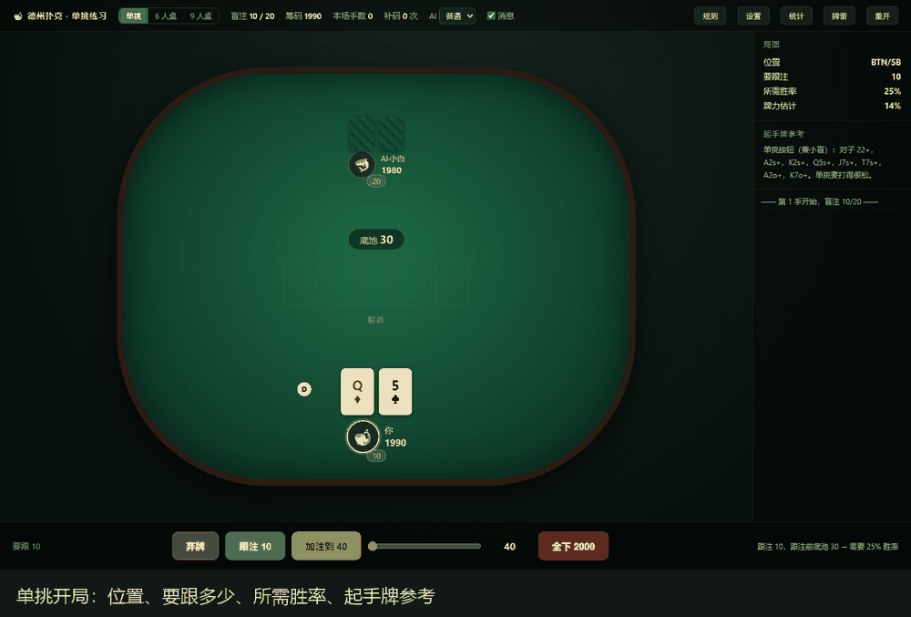

# 德州扑克 · 单文件练习器（GTO 版）

一个开箱即玩的德州扑克练习器：6 人桌 / 9 人桌都能打，内置 GTO 翻前表、七种性格的 AI 对手、实时胜率估算和 GTO 学习面板。
纯前端，双击 `index.html` 就能玩，不需要联网、不需要安装、不需要构建。



**一句话功能**：GTO 翻前表 · 七种性格 AI · 三档难度 · 实时胜率 · 复盘讲评 · 牌谱回放 · 统计与成就 · 挑战模式 · 新手引导 · 三套配色 · 现场合成音效 · 手机竖屏与横屏适配。

在线玩：<https://inorimutsumi.github.io/texas-holdem-trainer/>

---

## 一、怎么开始

双击 `index.html`（推荐 Chrome / Edge）。

顶栏从左到右：桌型（6 人桌 / 9 人桌）、盲注、筹码、补码次数、AI 难度、消息开关，
右侧是 GTO 表、规则、设置、统计、牌谱、重开。

第一次玩建议：

1. 难度选「熟练」
2. 点右侧「规则」看一遍操作
3. 玩几手后点「牌谱」看复盘
4. 点「GTO 表」翻一翻 169 手牌的开池范围

---

## 二、这一版加了什么

### 1. 内置 GTO 翻前表

26 个真实求解场景，覆盖 169 种起手牌：

- **开池**：UTG、UTG1、LJ、HJ、CO、BTN、SB 七个位置
- **应对开池**：CO / BTN / SB / BB 面对各位置开池
- **被 3bet 后**：原开牌者的继续策略

每个格子给出的是**混合频率**，不是简单的「打 / 不打」。比如 BTN 的 A5s 可能是「加注 65% / 跟注 35%」，
AI 会真的按这个比例掷骰子，所以你看到的是真正的随机化策略。

数据来自 [matthiola0/poker-hand-review](https://github.com/matthiola0/poker-hand-review)（MIT 许可）的
8-max MTT 翻前解，转成 30KB 的精简格式后**内联进 `index.html`**（所以单文件依然能独立运行）；`gto-data.js` 保留为源文件，方便以后用 `开发工具/build-gto.js` 重新生成。

### 2. 七种性格的 AI

每个座位在开局时随机分配一种性格，**同一张桌子上至少出现 3 种不同的性格**：

| 性格 | 打法 | 典型表现 |
|---|---|---|
| 均衡 | 按 GTO 打，轻微偏离 | 没什么明显漏洞 |
| 紧凶 | 只玩好牌，但玩得很凶 | VPIP 低、加注多 |
| 松凶 | 什么牌都想玩，还爱加注 | VPIP 高、压迫感强 |
| 跟注站 | 什么都跟，几乎不加注 | 弃牌极少、很难被诈唬走 |
| 紧弱 | 只玩好牌，但不敢加注 | 好牌也常常只跟 |
| 松弱 | 玩得多、打得软 | 爱看翻牌、不爱加注 |
| 疯子 | 疯狂加注和诈唬 | 波动极大 |

### 3. 三档难度：新手 / 熟练 / 职业

性格影响的是**翻前进入率、加注占比、跟注倾向、下注尺度**，不改变翻后的胜率计算。
难度单独控制「查不查 GTO 表」「用不用底池赔率」「读不读人」「算得准不准」「会不会手滑」，
两者是独立的两根轴。

| 难度 | 定位 | 它缺什么 |
|---|---|---|
| 简单 | 新手 | 不查 GTO 表，只看牌力；不算底池赔率，跟注门槛拍脑袋；不读你的数据；不估对手范围；胜率只抽 280 次；19% 概率乱打；面对大注容易被吓跑；不爱主动下注 |
| 普通 | 熟练 | 查表 + 算赔率 + 会读人，每步 1200 次胜率抽样；偶尔手滑（约 3% 的决策会打错）；会打薄价值（胜率刚过半也敢小注）；翻后按「对手随机两张牌」估胜率 |
| 困难 | 职业 | 查表 + 算赔率 + 会读人 + **零失误**，抽样提到 1800 次；翻后尺度与赔率判断都更严谨 |

> 说明：职业档**没有**启用"范围追踪 / MDF / 随机下注尺度 / 慢打 / 二次开火"这些 GTO 高级组件。
> 全部实现并实测过，对弱玩家一律是负收益（详见 [资料/难度提升报告.md](资料/难度提升报告.md)）。
> 职业档的强度来自"算得更准、绝不手滑"，而不是"花招更多"。

同性格、同牌局下实测（普通玩家陪练，每手重置 100BB，8 轮 × 400 手）：

```
easy   +34.67 BB/100（6400 手）
normal +112.31 BB/100（6400 手）
hard   +249.09 BB/100（3200 手）
```

三档单调递增，职业档是新手档的 7 倍。**注意这个数字的方差很大**：同样是职业档，
换一批座位分配会跑出 +53 ~ +296 的区间，因为 6 人桌每轮只有 1 个职业座位，
位置运气会显著影响单轮结果。上面的 +249 是跑满 8 轮、3200 手后的收敛值。

原因和完整的消融实验记录见 [资料/难度提升报告.md](资料/难度提升报告.md)——**给 AI 加"更 GTO 的功能"反而会让它打弱玩家时变弱**，这是这一轮最值钱的发现。

### 4. GTO 学习面板

顶栏「GTO 表」打开 13×13 起手牌矩阵，可以切换 26 个场景，看清每个位置该玩哪些牌：

- 红色 = 加注，蓝色 = 跟注，深灰 = 弃牌
- 格子里的 `R65` 表示加注 65%，`C35` 表示跟注 35%
- 鼠标悬停能看到完整的三项频率

牌桌上右侧还有一条**实时提示**：轮到你行动时，会显示当前局面下这手牌的 GTO 建议，
例如 `GTO｜开池 · BTN：加注 83% / 跟注 9% / 弃牌 8%`。

### 5. 风格是保密的

AI 的性格**不会显示出来**。没有标签、没有悬停提示、牌谱里也不会记。

想知道对面是疯子还是跟注站，只能自己观察：

- 他是不是什么牌都跟？（跟注站）
- 他是不是很少加注，但一加注就是大牌？（紧弱）
- 他是不是隔三差五就加注、甚至全下？（疯子 / 松凶）
- 他是不是等了好久才进一次池？（紧凶）

同一局里七种性格会被洗开分给每个 AI，一张 6 人桌上通常五个对手五种性格，够你猜的。

### 6. AI 会读你，也会上头

每个 AI 都在偷偷给你记账：

- 你进了多少手池、弃了多少手、翻后主动下注了几次，它都数着
- 攒够 6 手牌之后，它会给你贴标签：进池超过 50% 算「松鱼」，低于 26% 算「紧手」
- **桌上有松鱼**：它诈唬得更少（诈唬鱼没意义）、价值下注更薄、更愿意缠着你
- **桌上有紧手**：它的弃牌线抬高，不会拿边缘牌跟你拼命

它自己也会情绪化。一手牌里输掉超过 30% 筹码，它就「上头」了：

- 上头时弃牌线下降、加注频率上升、说话开始带火气
- 赢了大池会冷静一点，每手牌情绪自然消退 8%
- 所以你可能遇到「明明该弃却跟到底」的对手——那不一定是 bug，是他真的急了

它的思考时间也不是固定的：底池越大想得越久，牌力不上不下（胜率 34%–66%）时最犹豫，
跟注站和紧弱想得慢一点，疯子和紧凶出手快。

### 7. 其他

- **AI 之间会聊天**：有人大加注或全下时，另一个 AI 有 30% 概率接一句（「又加？」「你真有牌？」「这尺寸有意思」）；连续 3 手没人说话，会随机两个 AI 一来一回；赢走大池会被对手酸一句（「运气不错」「下次我不会跟了」）。**每手最多 2 句**，只说已经发生的公开事实，绝不提自己手里的牌
- AI 座位不会显示性格标签，也不会在摊牌或牌谱里揭示——风格要靠观察
- 翻后每一步都用蒙特卡洛现场估算胜率，三档难度分别抽 280 / 1200 / 1800 次
- 牌谱、复盘讲评、统计面板沿用原版

### 8. 声音与配色

- **背景音乐**：浏览器现场合成的爵士循环（ii-V-I-vi），钢琴分解 + 贝斯 + pad + 稀疏铃声，**没有任何音频文件**，单文件特性保持不变
- **音效**：发牌、下注、输赢、轮到你，全部现场合成；音量可在设置里单独调
- **三套牌桌配色**：绿毯 / 蓝调 / 木桌，设置里一键切换，自动记住；牌背、边框、强调色会跟着变
- 顶栏「🔊 声音 / 🔇 静音」一键切换背景音乐
- 浏览器要求先有一次点击或按键才能出声，所以第一次打开时是安静的，点一下就开始
- AI 的台词用**文字气泡**显示（下注、弃牌、摊牌嘲讽、嘴炮），不念出来。人声依赖系统 TTS，在部分 Windows 机器上会直接 `synthesis-failed`；与其带一个时灵时不灵的功能，不如干脆不做

### 9. 刺激感

- **河牌逆转提示**：你在转牌领先、被对手最后一张反超时，屏幕红闪一下 + 低沉音效，结算框单独说明「这种输法不算你打错，别上头」
- **连击播报**：连赢 2 / 3 / 5 手或连输 3 / 5 / 8 手会飘一行字，赢是金色、输是红色
- **节奏会呼吸**：没人下注时 AI 秒过（约 0.2 秒），面对大注会长考（约 0.7 秒），河牌阶段稍慢，不再是一律 400–800ms
- **目标感**：没在挑战时，顶栏 🏆 会缓慢脉冲；每手结算底部提醒「想要明确目标就开挑战模式」
- **AI 会心里有数**：输大池会上头（更爱诈唬、加注更凶），赢回来会冷静下来——这不是演的，`tilt` 值真的参与决策

### 10. 挑战模式

顶栏的 🏆 打开。挑战期间**不能补码**：输光就是输光，失败后筹码清零，要重新开挑战。

| 模式 | 目标 | 起手筹码 |
|---|---|---|
| 生存 | 100 手不破产，撑到最后算通关 | 2000 |
| 冲刺 | 30 手内从 2000 打到 3000 | 2000 |
| 翻倍 | 50 手内从 2000 翻到 4000 | 2000 |

- 顶栏会一直显示进度：「冲刺 · 12/30 手 · 2450/3000」
- 通关手数会被记进 `poker.challenge.v1`，下次打开还在
- 赢下一个够大的池子（30 个大盲 / 半仓 / 1000 以上）会飘金色大字 + 屏幕轻震

### 11. 等级与成就

统计弹层（顶栏「统计」）最下面。等级按**累计手数**自动升：新手上桌 → 常客（100 手）→ 老手（500 手）→ 牌桌灵魂（2000 手），升格时顶部飘一行提示，不打断牌局。

八条成就，没解锁前显示灰色的「？？？」：

| 成就 | 条件 |
|---|---|
| 第一桶金 | 第一次赢下底池 |
| 大赢家 | 单个底池赢到 5000 以上 |
| 铁头 | 连续 10 手不弃牌 |
| 亡命徒 | 全下并赢下 3 次 |
| 翻身 | 从 1000 打到 5000 |
| 马拉松 | 累计打满 2000 手 |
| 挑战者 | 通关任意挑战模式 |
| 天选 | 拿到四条或以上并赢下 |

存在 `poker.profile.v1`，跟着这个浏览器的本地存储走。

---

### 12. 发牌风格（真实 / 热闹 / 炸裂）

设置面板里可以换发牌风格。默认是**真实**，按真实概率发牌。

德州扑克本来就是这样：6 人桌上大约七成手牌第一反应就是弃牌，连弃十手是常态而不是 bug。如果你觉得"打了半天全是垃圾牌"，可以换到另外两档：

| 档位 | 全桌至少能成 | 重洗上限 | 玩家保底 |
|---|---|---|---|
| **真实** | — | 不重洗 | — |
| **热闹** | 两对以上 | 3 次 | 连弃 3 手后下一手底牌 ≥ 0.55 |
| **炸裂** | 三条以上 | 5 次 | 连弃 2 手后下一手底牌 ≥ 0.60 |

实测 400 手的牌型分布：

| 牌型 | 真实 | 热闹 | 炸裂 |
|---|---|---|---|
| 两对以上 | 83.3% | 99.8% | 99.5% |
| 三条以上 | 48.0% | 58.8% | 98.5% |
| 平均重洗 | 0 次 | 0.20 次 | 0.97 次 |

**注意**：只保证"有牌打"，不保证赢。好牌照样会被反超，这才是德州扑克。想认真学概率就用真实档。

调试参数：`?deal=real|fun|wild`

### 13. 手机横屏

横屏（844×390 这类）不是把竖屏压扁，而是单独排的一版：

- 牌桌横向铺满整个屏幕，座位沿扁椭圆分布，9 人桌也不重叠
- 你的手牌移到座位**右侧**，不再挡住底池和公共牌
- 其他玩家的下注筹码贴在各自座位右侧，不会和底池撞在一起
- 底栏压缩，弃牌 / 跟注 / 加注 / 全下四个按钮并排一屏放下
- 右侧信息栏（位置、所需胜率、GTO 建议）收成抽屉，点「信息」滑出，**不遮挡底栏按钮**；点牌桌区域收起
- 桌面端（1440×900）和手机竖屏（390×844）完全不受影响

## 三、AI 是怎么想的

### 单手计划（v11 起）

以前每个 AI 每一街**独立算一次**：算胜率、比门槛、下注或弃牌。结果是它翻牌加注、转牌突然过牌、河牌又加注——**没有故事**，你读不出它。

现在每手牌开局只掷一次意图，整手按意图走：

| 意图 | 行为 |
|---|---|
| `value` 价值 | 每一街主动下注，尺度略大（×1.10） |
| `bluff` 诈唬 | 翻前开池 → 翻牌必下（60%）→ 转牌继续（40%）→ **河牌没成牌就撤** |
| `draw` 听牌 | 便宜就跟，成牌后切成价值打法 |
| `trap` 慢打 | 强牌憋着，河牌 40% 概率突然发难 |
| `giveup` 放弃 | 除非免费，否则直接弃 |

关键是**诈唬要连成一条线**：它不会翻牌下注、转牌无缘无故过牌——要么一路开火到河牌，要么河牌认输。这才叫「他在演一个故事」。

新手档**不开**计划（新手要「看起来傻」，有计划反而露馅）。

调试：`?debug=plan` 在右侧栏显示每个 AI 本手的意图。

### AI 记住你（v11 起）

之前的「AI 读你」是**聚合比率**（你面对下注弃了 60%），说不出「你刚才干了什么」。现在多了一层**事件记忆**：最近 30 手里你做了什么都记着——翻前弃牌、河牌弃牌、大注跟注、主动加注、摊牌强弱。

它只记**公开信息**，代码里明确禁止读你的底牌。

能听出来的三句话：

- 连续几手翻前弃牌 → 「又弃？你这椅子是不是太硬了」
- 最近 5 手里 3 次河牌弃牌 → 「你河牌跑得有点快啊」
- 最近 3 手里 2 次加注 → 「今天手气不错嘛」

**只会对「职业」档生效**：职业档还会拿这些数据调自己的诈唬频率和跟注门槛（河牌老弃 → 多开火；摊牌老出弱牌 → 跟注门槛降低）。新手和熟练档只当台词，不影响决策。


没有神经网络，没有训练，没有权重文件。它由三部分组成：

**翻前**：查 GTO 表 → 叠加性格系数 → 按难度做模糊化 → 掷骰子执行。
比如表里说「加注 45% / 弃牌 55%」，一个松凶的 AI 会把加注占比抬高、把弃牌改成跟注，
一个紧弱的 AI 反过来。难度越高，模糊化越少，越接近表里的原始频率。

**翻后**：用蒙特卡洛现场估算胜率。随机给对手发牌、随机补完公共牌，跑 N 次比大小，
得到「这手牌现在大概有多少胜率」，再根据底池赔率和性格阈值决定跟、加、弃。

**心智层**：在上面两层之外，每个 AI 还维护一份「对手档案」和一份「自己的情绪」。
对手档案影响它怎么解读你的下注，情绪影响它愿不愿意放弃。这一层不参与胜率计算，
只调整决策阈值——所以它不会算得更准，但会打得更像人。

> 单挑（heads-up）的规则引擎仍然保留在 `createGame({ mode: 'hu' })` 里，供自测脚本使用；界面只提供 6 人桌和 9 人桌。
> 内置表是 8-max 的解，对单挑会窄得离谱，引擎里有一层「单挑进入率放宽」的经验修正。

**面对 4bet 以上**：内置表只解到 3bet，所以 AI 用一套极窄的兜底范围（QQ+/AK 起步，
疯子松一点到 TT/AQs）。早期版本这里会拿「防守 3bet 的宽范围」去跟全下，比真人松四倍，已经修掉。

**它不作弊**：AI 只能看到自己的底牌、公共牌、底池和还有几个人没弃牌，不会偷看你的牌。
它读的是你的**行为统计**，不是你的底牌。

---

## 四、文件说明

```
德州扑克/
├── index.html          ← 游戏本体（单文件，双击即玩）
├── README.md
├── LICENSE
├── test.js             ← 引擎单元测试（121 条断言）
├── check.js            ← 语法检查 + DOM 桩冒烟
├── 资料/               ← 方案、验收、难度报告等文档
├── 截图/               ← 界面截图与演示 GIF
└── 开发工具/           ← AI 对打、压测、截图、推送等脚本（内含 README 索引）
```

| 文件 | 作用 |
|---|---|
| `index.html` | 游戏本体，样式、引擎、界面、GTO 数据全内联，零依赖 |
| `test.js` | 引擎单元测试，`node test.js`（121 条） |
| `check.js` | 语法检查 + 无浏览器冒烟，`node check.js` / `check.js six` / `check.js nine` |
| `开发工具/gto-data.js` | GTO 翻前表源数据，30KB（已在 `index.html` 内联一份） |
| `资料/` | 设计文档：方案、后续开发方案、难度提升报告/方案、验收清单、自检报告、GPT 验收提示词 |
| `开发工具/aibench.js` | 两档 AI 直接对打（`node 开发工具/aibench.js 300 normal hard`） |
| `开发工具/aibench2.js` | 对打 + VPIP/PFR/WTSD 统计，调参用 |
| `开发工具/sixmax.js` | 6 人桌 60 手随机压测 |
| `开发工具/sim.js` | 风格对打赛，统计每个性格的 VPIP/PFR |
| `开发工具/replay.js` | 实战复盘，打印完整行动日志与心智状态 |
| `开发工具/bench.js` | 三档难度对打赛 |
| `开发工具/style-bench.js` | 七种性格对打赛 |
| `开发工具/build-gto.js` | 从上游重新抓 GTO 表（需联网） |
| `开发工具/README.md` | 上面这些脚本的用途与口径索引 |
| `开发工具/inline-gto.js` | 把 `gto-data.js` 内联进 `index.html` |
| `开发工具/shot-mobile.js` | CDP 真机视口截图（Edge headless 的 `--window-size` 有 492px 下限，必须走 CDP） |
| `开发工具/make-shots.sh` | 批量重截界面图 |
| `开发工具/make-demo-gif.py` | 拼演示 GIF |
| `开发工具/push-api.js` | GitHub Data API 推送（git 直连被墙时用） |
| `开发工具/sync-check.js` / `sync-pull.js` | 与远程逐文件比对 / 拉取 |
| `LICENSE` | MIT |

想改数据？`gto-data.js` 是纯 JSON 结构：

```js
window.GTO_TABLE = {
  meta: { ... },
  hands: ['AA','AKs',...,'22'],        // 169 项，行优先
  spots: { 'rfi/BTN': ['r', 'r0.45c0.55', ...], ... }   // 26 个场景，每场景 169 项
};
```

动作串：`r` = 加注，`c` = 跟注，`a` = 全下，`f` = 弃牌，后面跟频率（1 省略）。
空串 `""` 表示纯弃牌。

---

## 五、已知限制

- **翻后没有 GTO**。完整的翻后解是 TB 级的，内置不现实；翻后靠实时蒙特卡洛，够用但不到 GTO 水平。
- **单挑的放宽是经验值**，不是解出来的最优策略；界面已不提供单挑入口。
- **6 人桌 / 9 人桌的位置映射**按「后面还剩几人」对齐到 8-max 表，边缘位置（比如 9 人桌的 UTG+1）会共用一张表。
- 表里的频率做了归一化：源数据有 10 条手牌四项频率和不是精确 1，已按比例调整到 100%。

---

## 六、致谢

- 原始游戏：[InoriMutsumi/texas-holdem-trainer](https://github.com/InoriMutsumi/texas-holdem-trainer)（MIT）
- GTO 数据：[matthiola0/poker-hand-review](https://github.com/matthiola0/poker-hand-review)（MIT）

两边的 MIT 许可都保留在 `LICENSE` 里。

## AI 调参踩过的坑

给以后想继续调 AI 的人（包括我自己）：

| 试过的改动 | 结果 | 结论 |
|---|---|---|
| 对手范围门槛 `oppMin` 从 0.48 降到 0.40 | `hard vs normal` 从 +3286 变 -788 | **AI 变松 ≠ 变强**，范围估得乐观就是送钱 |
| 给 `rangeOf` 的下注权重留 22% 均匀（诈唬感知） | 从 +6352 掉到 **-12405** | 它区分不了「对手在诈唬」和「对手有牌」，只会变松 |
| C-bet 从 62% 降到 52% | WTSD 纹丝不动 | 摊牌率低不是 C-bet 造成的 |
| 关掉范围追踪 | WTSD 还是 6.3–8.8% | 也不是范围收窄造成的 |

**硬约束**：任何 AI 改动，跑 `node 开发工具/aibench.js 300 normal hard`，**只要 hard 不是正数就回滚**，不调参、不找理由。WTSD 可以慢慢追，强度是底线。

当前 WTSD 约 8–10%（GTO 基准 27–32%），已知达不到。原因是这套 AI 是**单街阈值决策**——它没有「对手这次可能在诈唬」这个维度的判断能力，能做的只有整体变松或变紧，而变松在这套模型里必然变弱。真要达标得重写翻后决策结构，不是调参能解决的。
