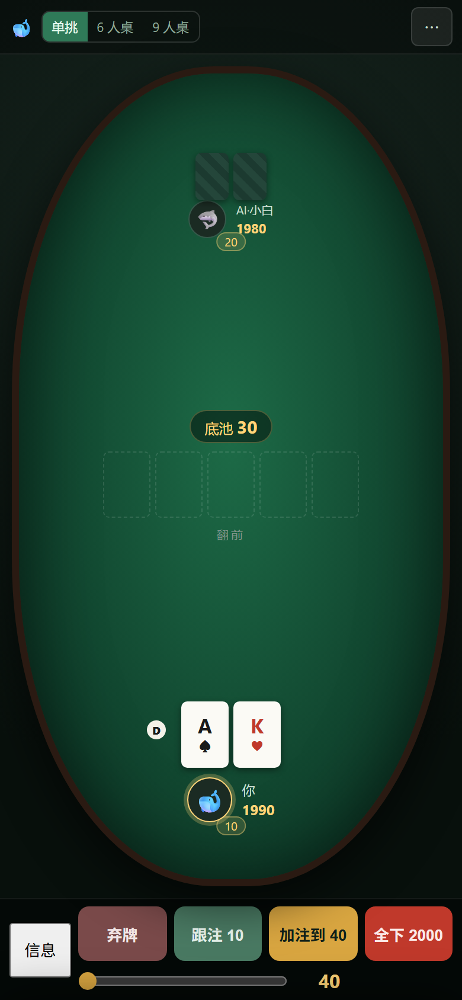
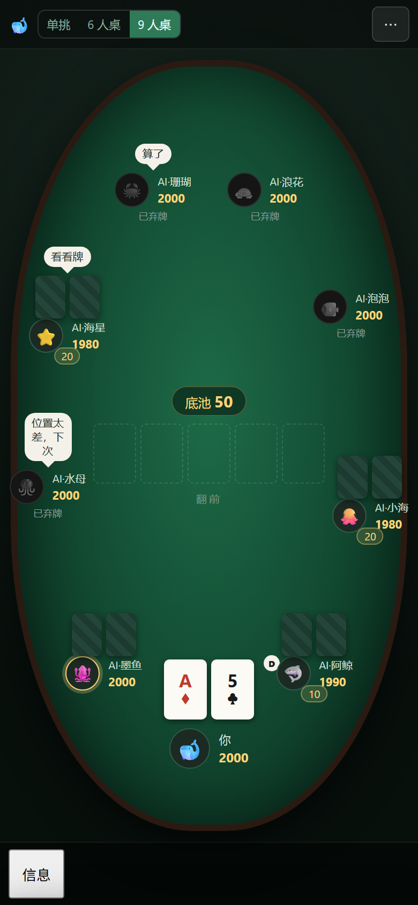

# 德州扑克 · 本地练习

**在线试玩**：<https://inorimutsumi.github.io/texas-holdem-trainer/>

本地离线、单文件、双击即玩。规则引擎按 `资料/方案.md`（v9）实现，六批迭代计划全部完成。


## 打开方式

- 在线：点上面的链接，手机和电脑都能开
- 本地：双击 `index.html`（不需要联网、不需要服务器、没有任何外部依赖）

## 手机

手机竖屏（以 390×844 为基准）可以直接玩，电脑端布局完全不变：

- 顶栏收成「🐋 + 牌桌切换 + ⋯」，规则 / 设置 / 统计 / 牌谱 / 重开都在 `⋯` 里
- 右侧信息栏变成底部抽屉，点底部的「信息」滑出，点牌桌区域收起
- 底部操作按钮高度 46px，加注滑条单独一行，手指点得准
- 座位按竖向椭圆重新分布，9 人桌也不重叠
- 横屏也能用，布局自动收紧（`@media (max-width: 899px)` 隔离）




## 能玩什么

**牌桌**
- 单挑 / 6 人桌 / 9 人桌，顶栏直接切，切了会重开一局
- 无限注德州扑克全流程：盲注、四轮下注、过牌/跟注/加注/全下/弃牌、边池、摊牌比牌、位置轮转
- 单挑翻前 BTN/SB 先动、翻后 BB 先动；6/9 人桌按 UTG 起顺时针
- 盲注可在「设置」里改（大盲不能小于小盲），默认 10/20

**AI**
- 三档：新手 / 普通 / 老手
- 位置修正：按钮位敢玩、枪口位收紧
- 老手会诈唬、面对小注多跟；任何档位都看不到你的底牌

**学牌**
- 新手教学：顶栏「规则」→ 五个页签（怎么玩 / 牌型 / 行动 / 术语 / 策略），完全不懂也能从零看懂
- 牌型页：十种牌型从大到小，每种配一副真实牌面
- 右侧面板：位置、要跟注多少、所需胜率、牌力估计
- 起手牌参考：翻前按当前位置列可玩范围，翻牌后自动切走
- 每手结束的复盘讲评：把你每个决定标成「不错 / 可接受 / 有问题」，写出底池赔率和判断假设
- 牌谱回放：逐步播放、上一步/下一步、跳到某一手；点复盘里的「看这步」直接跳到对应动作
- 统计：VPIP、PFR、净盈亏、赢/输手数、盈亏曲线、按位置统计
- 笔记：每手可以写一句话，牌谱列表里有 📝 标记

**数据**
- 全部存 `localStorage`：牌谱 200 手滚动、笔记、头像、设置、补码事件
- 牌谱可导出 JSON、可导入（按 `time + id` 去重），笔记一起带走

**其他**
- 点头像换头像（12 个内置头像 + 上传图片，图片压到 64×64、不超过 8KB）
- 键盘：`1` 弃牌、`2` 跟注/过牌、`3` 加注、`4` 全下、`Esc` 关弹层
- 关掉「消息」只停新消息，规则、牌谱、历史消息都不动

## 自测

需要 Node.js：

```bash
node test.js         # 规则引擎 104 条断言
node check.js        # 语法 + DOM 桩冒烟（单挑随机打完 10 手）
node check.js six    # 同上，6 人桌
node check.js nine   # 同上，9 人桌
node _sixmax.js      # 6 人桌 60 手随机压测
```

`test.js` 直接从 `index.html` 里抽取 `<script id="engine">` 运行，不复制代码。

调试用 URL 参数（正常打开不受影响）：

- `?table=hu|six|nine` 指定牌桌
- `?auto=4` 自动随机行动打完 4 手
- `&hist=1` 打完开牌谱列表，`&hand=1` 直接看最近一手
- `&stats=1` 打完开统计
- `&avatar=1` 打开头像选择器
- `&guide=flow|hands|actions|terms|strategy` 直接打开规则教学对应页签

## 文档

| 文件 | 说明 |
|---|---|
| `资料/方案.md` | 设计文档 v9，规则以它为准 |
| `资料/验收清单.md` | 对照方案 §11 四条硬指标的逐项验收表 |
| `资料/自检报告.md` | 自测结果、覆盖范围、已知偏差 |
| `资料/GPT验收提示词.md` | 可直接粘贴给 GPT 的核验提示词 |

## 文件

| 文件 | 说明 |
|---|---|
| `index.html` | 游戏本体（单文件，2759 行） |
| `test.js` | 规则断言（104 条） |
| `check.js` | 冒烟测试 |
| `_sixmax.js` | 6 人桌随机压测 |
| `make_demo_gif.py` | 用截图重新生成 README 顶部的演示 GIF |
| `make_shots.sh` | 批量重新截桌面界面图 |
| `_shot_mobile.js` | 用 CDP 模拟手机视口截图（Edge headless 的 `--window-size` 有最小宽度限制，390 会被抬到 492，必须走 CDP） |
| `截图/界面-*.png` | 桌面界面预览（12 张） |
| `截图/手机-*.png` | 手机界面预览（5 张） |

## 许可证

[MIT](LICENSE) —— 可以随便用、改、再发布，保留版权声明即可。

